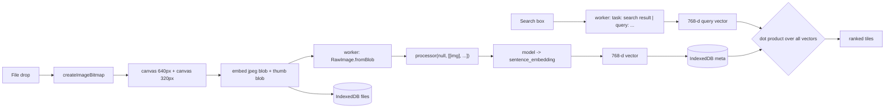

# Meme Vault

**Search your meme folder by describing what you remember. Everything runs in one browser tab.**

Drop a folder of 2,000 memes in. Type *"the dog in the burning room"* and get the image back,
even though nobody ever tagged it and the filename is `IMG_4821.PNG`. The model, the embeddings,
the index and the search all live on your machine. After the one-time model download you can pull
the wifi and keep searching.

No server. No API key. No account. No upload.
---

## Table of contents

1. [Why this exists](#why-this-exists)
2. [What it does](#what-it-does)
3. [Verified behaviour](#verified-behaviour)
4. [Quickstart](#quickstart)
5. [Architecture](#architecture)
6. [How it works, with code](#how-it-works-with-code)
7. [The four traps that cost the most time](#the-four-traps-that-cost-the-most-time)
8. [Project structure](#project-structure)
9. [Testing](#testing)
10. [Limitations, stated honestly](#limitations-stated-honestly)
11. [Contributing](#contributing)
12. [Feature ideas, roughly by difficulty](#feature-ideas-roughly-by-difficulty)

---

## Why this exists

Two things are true at once:

1. **Everyone has a meme folder they cannot search.** 1,500 files, useless filenames, no tags.
   Keyword search is hopeless because the thing you remember is *the picture*, not the name.
2. **Nobody wants to upload that folder to a server.** Even ignoring the privacy instinct, a
   normal vision-embedding pipeline means shipping gigabytes of personal images to someone
   else's GPU and paying per call.

Multimodal embedding models small enough to run on a laptop changed the second constraint, and
`EmbeddingGemma 2` in a browser tab changed the first. This is the smallest useful thing you can
build with that: a text-to-image index that never leaves the tab.

The whole app is a static site. `dist/` is ~26 MB because the ONNX Runtime WASM binary is bundled
with it, so it self-hosts and works on any static host, including a file server on a LAN.

## What it does

- **Ingest**: drop files or a whole folder. Images are decoded, thumbnailed and embedded once.
- **Search**: type a description. Results are ranked by cosine similarity, with the score shown.
- **Browse**: with an empty query, the vault is just a masonry grid of everything.
- **Persist**: the index lives in IndexedDB, so a reload keeps the vault.
- **Offline**: the model is cached by the browser, the vectors are local, and the worker stays
  loaded. Search keeps working with the network off.
- **Honest UI states**: download progress in MB, indexing progress, a WASM fallback notice, an
  explicit error state, empty states that teach, keyboard focus that is visible.

## Verified behaviour

Not "should work". These are from `scripts/e2e.py`, driving real headless Chrome with WebGPU,
indexing six real photos plus two memes composited from them:

| Query | Rank 1 | Score | Runner-up |
| --- | --- | --- | --- |
| `a cat` | cat.jpg | 0.71 | 0.63 |
| `pizza` | pizza.jpg | 0.73 | 0.61 |
| `the eiffel tower` | eiffel.jpg | 0.75 | 0.60 |
| `a banana` | meme-banana.png | 0.77 | banana.jpg 0.77 |
| `a painting of a woman` | monalisa.jpg | 0.73 | 0.56 |
| `a golden retriever` | meme-dog.png | 0.75 | dog.jpg 0.71 |

Timings on an Apple M4 with WebGPU:

- model ready in **57 s** (284 MB, browser-cached afterwards)
- 8 images indexed in **17 s** (about 2 s/image including decode and thumbnail)
- query latency **~0.3 s**
- offline search, after `context.set_offline(True)`: identical results
- reload: 8/8 memes kept, `pizza` still ranks pizza.jpg first

One result worth noticing: the *meme* built from the banana photo ties the original banana photo
(0.77 both), and the dog meme beats the dog photo for "a golden retriever". The model reads the
picture, so the caption is just more picture. That is exactly the behaviour this product wants.

## Quickstart

```sh
npm install
npm run dev       # http://localhost:5173
npm run build     # static site in dist/
npm run preview   # serve dist/ on http://localhost:4173
```

Try it with the sample images that ship in `test-images/` (6 photos, 2 memes).
Chrome or Edge 113+ gets WebGPU. Anything else falls back to WASM, which works but downloads
879 MB instead of 284 MB, so the app tells you when that happens.

Node 20+ for the build. No other system dependencies.

## Architecture

Three processes, one page. The model must not block the UI, so it lives in a worker.

```
┌─────────────────────────────── browser tab ───────────────────────────────┐
│                                                                           │
│  ┌──────────────┐   blobs    ┌──────────────────────────────────────────┐  │
│  │  Main thread │ ─────────▶ │           Embedding worker               │  │
│  │              │            │                                          │  │
│  │ React UI     │            │  EmbeddingGemma 2 (ONNX, WebGPU)         │  │
│  │ ingest.ts    │ ◀───────── │  ├─ text backbone  270M  (q4, 174 MB)    │  │
│  │ (canvas,     │  Float32   │  ├─ vision encoder 170M  (q4, 109 MB)    │  │
│  │  thumbs)     │  [768]     │  └─ audio encoder 300M  disabled         │  │
│  │              │            │                                          │  │
│  │ search.ts    │            │  batch → processor → model → embedding   │  │
│  └──────┬───────┘            └──────────────────────────────────────────┘  │
│         │                                                                 │
│         ▼                                                                 │
│  ┌─────────────────┐        ┌──────────────────────────────────────────┐  │
│  │ IndexedDB       │        │ Cache Storage                            │  │
│  │ ├ meta  (thumb, │        │   model graphs, cached after first load  │  │
│  │ │        vec)   │        └──────────────────────────────────────────┘  │
│  │ └ files (bytes) │                                                      │
│  └─────────────────┘                                                      │
└───────────────────────────────────────────────────────────────────────────┘
```

Data flow, ingest to result:



Why this shape:

- **Worker, not main thread.** A 740M model on WebGPU blocks for 200-300 ms per forward pass.
  In the worker, the UI stays responsive and the app can show real progress.
- **One model, two modalities.** Text and images share one 768-d space, which is why a typed
  description can match a picture. That is the whole trick; there is no captioning step.
- **Two IndexedDB stores.** `meta` holds the thumbnail and the vector, `files` holds the original
  bytes. Browsing 2,000 memes then costs one small read instead of decoding 2,000 full-size images.
- **Static host.** No backend means no cost, no scaling story, and no way for the images to leave.

## How it works, with code

### 1. Loading the model, and choosing quantisation per device

`src/embed/worker.ts`:

```ts
const config: any = await AutoConfig.from_pretrained(MODEL_ID);
// Audio is not part of this app, so its 300M encoder never downloads.
config.audio_config = null;

const [processor, model] = await Promise.all([
  AutoProcessor.from_pretrained(MODEL_ID, { progress_callback }),
  AutoModel.from_pretrained(MODEL_ID, {
    config,
    device,          // 'webgpu' | 'wasm'
    dtype,           // q4 on WebGPU, fp16 on WASM, see the traps section
    progress_callback,
  }),
]);
```

`src/embed/config.ts` holds the numbers that matter:

```ts
export const DIM = 768;
export const DTYPE = {
  webgpu: { model: 'q4',   vision_encoder: 'q4'   },
  wasm:   { model: 'fp16', vision_encoder: 'fp16' },
};
export const DOWNLOAD_MB = { webgpu: 284, wasm: 879 };
export const IMAGE_TOKENS = 282;              // 280 soft tokens + markers
export const BATCH_BUDGET = { webgpu: 2600, wasm: 300 };
export const queryPrefix = (text: string) => `task: search result | query: ${text.trim()}`;
```

### 2. Embedding images

```ts
/** Batches so that count × 282 tokens stays under the device budget. */
function pack(blobs: Blob[], device: Device): Blob[][] {
  const perBatch = Math.max(1, Math.floor(BATCH_BUDGET[device] / IMAGE_TOKENS));
  const batches: Blob[][] = [];
  for (let i = 0; i < blobs.length; i += perBatch) batches.push(blobs.slice(i, i + perBatch));
  return batches;
}

const images = await Promise.all(batch.map(async (blob) => [await RawImage.fromBlob(blob)]));
const out = await run(null, images);   // one list per image, not a flat list
```

and the single inference entry point, which is also where the tensor lifetime is handled:

```ts
async function run(...inputs: any[]): Promise<Float32Array[]> {
  const processed = await state.processor(...inputs);
  const output = await state.model(processed);
  const flat = new Float32Array(output.sentence_embedding.data);  // copy before dispose
  for (const tensor of [...Object.values(output), ...Object.values(processed)]) tensor?.dispose?.();
  const count = flat.length / DIM;
  return Array.from({ length: count }, (_, i) => flat.slice(i * DIM, (i + 1) * DIM));
}
```

### 3. Ingest on the main thread

Everything that is not the model is ordinary DOM work. Decode, downscale, encode, store:

```ts
const full  = draw(source, 640);   // what the model sees
const thumb = draw(source, 320);   // what the grid shows
const embed = await toBlob(full.canvas, 'image/jpeg', 0.9);
const thumbBlob = await toBlob(thumb.canvas, 'image/webp', 0.82);
```

Normalising to a 640 px JPEG before the worker has two benefits: every input format the browser
can decode (GIF, WebP, AVIF, SVG) becomes something the model accepts, and a 4 MB photo stops
being 4 MB of transfer into the worker.

Ingest is chunked, so a tab crash keeps the work already done:

```ts
const groupSize = device === 'wasm' ? 4 : 16;
for (let start = 0; start < embedBlobs.length; start += groupSize) {
  const vectors = await embedder.embedImages(embedBlobs.slice(start, start + groupSize));
  for (const [offset, id] of ids.entries()) {
    await setVector(id, vectors[offset]);        // one write per vector
    setMemes((current) => current.map((m) => (m.id === id ? { ...m, vector: vectors[offset] } : m)));
  }
  setIndexing({ done: start + groupSize, total: embedBlobs.length });
}
```

### 4. Search is a dot product

The model L2-normalises every vector, so cosine similarity collapses into a dot product:

```ts
const scored = pool.map((meme) => {
  const vector = meme.vector!;
  let dot = 0;
  for (let i = 0; i < vector.length; i++) dot += vector[i] * queryVector[i];
  return { meme, score: dot };
});
scored.sort((a, b) => b.score - a.score);
```

2,000 memes × 768 dimensions is 1.5M multiply-adds: about a millisecond. There is no ANN index
and there does not need to be one until roughly 100k items.

Search is debounced 400 ms and runs on every keystroke, because a local forward pass is cheaper
than the round trip a cloud API would need.

### 5. Where the state lives

```ts
// src/vault/db.ts: two stores, one database
meta:  { id, name, addedAt, bytes, width, height, thumb, thumbType, vector }
files: { id → original Blob }
```

`meta` is what startup reads. `files` is only touched when a lightbox opens.

## The four traps that cost the most time

**1. Quantisation is per device, and it is not a preference.**
`q4`, `q8` and `q4f16` text and vision graphs use `GatherBlockQuantized`, which the ONNX Runtime
WASM build has no kernel for. So WebGPU loads q4 (284 MB) and WASM *must* load fp16 (879 MB).
If you ship one dtype for both, the fallback path fails with an opaque kernel error.

**2. Images must go in as a list per image.**
`processor(null, [imgA, imgB])` merges the batch into a single input and you get one vector for
two images, silently. `processor(null, [[imgA], [imgB]])` returns two.

**3. Copy the tensor before you dispose it.**
`output.sentence_embedding.data` is a view over GPU-backed memory. Dispose first and you get
released or stale data. `new Float32Array(embedding.data)` is the one-line fix.

**4. Task prefixes are not optional decoration.**
Queries use `task: search result | query: ...`. Skip it and retrieval degrades quietly, which
looks like a bug in your ranking code rather than a prompt problem.

A fifth, subtler one is in the test harness rather than the app: waiting for `.score` to appear
passes instantly, because the *previous* query's scores are still in the DOM. The app exposes
`data-search-seq` so tests can wait for a result that is actually new. More in [Testing](#testing).

## Project structure

```
meme-vault/
├── index.html
├── package.json
├── tsconfig.json
├── vite.config.ts
├── src/
│   ├── main.tsx
│   ├── App.tsx              # UI, state machine, ingest + search orchestration
│   ├── styles.css           # token block, then components
│   ├── embed/
│   │   ├── config.ts        # model id, dtypes, budgets, token facts
│   │   ├── worker.ts        # model load, batching, inference (no DOM access)
│   │   └── client.ts        # RPC wrapper around the worker
│   └── vault/
│       ├── db.ts            # IndexedDB: meta + files stores
│       └── ingest.ts        # decode, downscale, thumbnail, folder walking
├── scripts/
│   ├── e2e.py               # Playwright end-to-end run with real model + real images
│   └── probe.py             # is WebGPU actually available here?
├── test-images/             # 6 photos + 2 memes for a first run
└── docs/
    ├── blog.md              # long-form technical write-up
    ├── x-thread.md
    └── linkedin.md
```

Roughly 900 lines of TypeScript across nine files.

## Testing

```sh
npm run build && npm run preview &
python3 scripts/e2e.py
```

The harness launches Chrome with WebGPU enabled, waits for the real model, indexes the sample
folder, runs six queries, asserts top-1 membership, then repeats a query with the browser set
offline, checks the lightbox, and reloads to prove persistence. Screenshots land in `shots/`.

Two things that make it reliable rather than flaky:

```python
# strict-mode violation: two file inputs (picker + folder picker)
page.locator("input[type=file]").first.set_input_files(IMAGES)

# wait for a NEW result, not for a score to exist
before = int(page.evaluate("() => document.querySelector('.app')?.dataset.searchSeq ?? '0'"))
page.fill(".searchbar input", text)
page.wait_for_function(f"() => Number(document.querySelector('.app')?.dataset.searchSeq ?? 0) > {before}")
```

The data attributes `data-phase`, `data-indexed`, `data-total`, `data-device`, `data-query` and
`data-search-seq` exist for exactly this. They are cheap and they turn a 2.5-minute test into a
deterministic one.

## Limitations, stated honestly

- **Text inside memes is not OCRed.** The model reads the picture. A query that only matches the
  caption, and not the visual content, can miss.
- **WASM costs 879 MB.** Gate it: warn before downloading, or refuse on low-memory devices.
- **Per-browser, per-profile storage.** Clearing site data deletes the vault. Original files on
  disk are untouched.
- **GIFs are indexed by their first frame.**
- **HEIC from an iPhone may not decode in Chrome.** Those files are skipped and reported by name.
- **No fixed score threshold.** Correct hits land at 0.70-0.77 and unrelated ones at 0.50-0.60,
  which is too narrow a band for a cut-off. Rank and show scores; do not filter on a magic number.
  The "close matches only" toggle is relative to the top hit for that reason.

## Contributing

```sh
git clone <your fork>
cd meme-vault
npm install
npm run dev
```

Then:

1. Open an issue describing the change before a large PR, so two people do not build the same
   thing. Small fixes can go straight to a PR.
2. Keep the worker free of DOM access. It must stay usable off the main thread.
3. If you touch model loading or batching, re-run `scripts/e2e.py` and paste the CHECKS line in
   the PR. A UI-only change does not need it.
4. Match the existing token system in `styles.css` rather than adding one-off paddings. New
   spacing values should come from the `--s1` to `--s8` scale, and new colours should be a role,
   not a hex literal in a component.
5. TypeScript strict is on. `npm run build` runs `tsc --noEmit` first, so it will fail on type
   errors before Vite ever runs.

Good first issues, all self-contained:

- Drag-to-reorder, or a "sort by file size / date added" control.
- A keyboard grid navigator (arrows, enter to open), since `/` already focuses search.
- Show decode failures as a retryable list instead of a single line of text.
- Make the storage estimate per-store, so the model cache is not counted as meme storage.

## Feature ideas, roughly by difficulty

**Easy (an evening)**

- **Paste to add.** `navigator.clipboard.read()` → the same `prepareImage` path. Most memes arrive
  by copy-paste, not by file.
- **Copy to clipboard** from the lightbox.
- **Export/import the index** as a JSON + folder zip, so a vault moves between machines.
- **Duplicate finder.** Cosine > 0.97 within the same collection, one click to delete extras.
- **Recent searches**, stored locally, one keystroke to re-run.

**Medium (a weekend)**

- **Collections.** A `collection` field in `meta`, and filtering that composes with search.
- **Zero-shot tags.** Pre-embed a small vocabulary ("reaction", "text-only", "screenshot",
  "chart", "animal") and label on ingest with the nearest concept. No LLM, still offline.
- **Audio memes.** Load the audio encoder (189 MB on WebGPU) and embed the sound files sitting in
  the same folders. Cross-modal search for free, one extra `dtype`.
- **Web Worker pool.** Two workers on machines with 16 GB+, so indexing overlaps with searching.
- **Persist the folder handle** with `showDirectoryPicker({ mode: 'read' })` and offer a one-click
  "rescan folder" that only embeds new files.

**Harder (a real project)**

- **Video memes.** Sample frames, embed in segments, return the matching timestamp. `RawVideo`
  and `RawVideoFrame` are already in Transformers.js; the work is segmenting and ranking.
- **On-device captions via a local LLM.** A 1-3B model in the same tab would let you search
  sentences that describe intent rather than appearance, and let the vault explain *why* a match
  scored high.
- **Phrase-level search inside memes** with a tiny OCR pass on the thumbnail, feeding the text
  encoder, then a hybrid text+image score.
- **Share a single meme without a server**: encode the vector into the URL fragment so the
  recipient's tab can re-rank it against their own vault.

**Where contribution actually matters**

The interesting engineering is not the UI. It is the ingest budget: how to keep 2,000 images
under a few minutes on a laptop while never blocking the thread, never OOMing a WASM heap, and
never silently dropping a vector. If you want to contribute something that matters, instrument
that loop and publish real numbers for different hardware.

---

## Credits

- **EmbeddingGemma 2** by Google DeepMind, Apache 2.0, weights and model card on Hugging Face.
- **Transformers.js** by Hugging Face for the ONNX runtime plumbing in the browser.
- **ONNX Runtime Web** for the WebGPU and WASM backends.
- The q4-on-WASM kernel mismatch and the per-image processor batching shape were documented by
  [`tpiros/embeddinggemma-browser-search`](https://github.com/tpiros/embeddinggemma-browser-search).
  This app is a separate implementation aimed at a different job.

## License

MIT. See [LICENSE](LICENSE).
